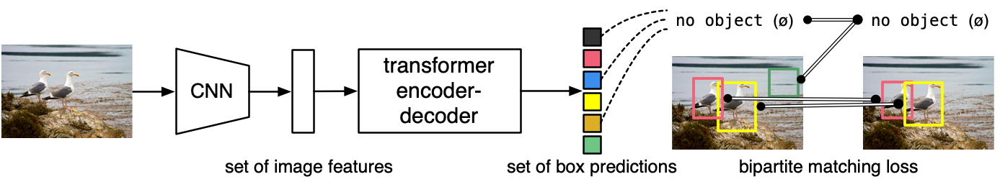
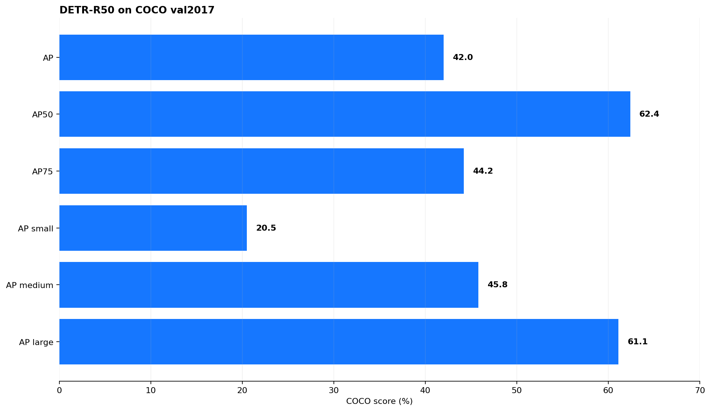
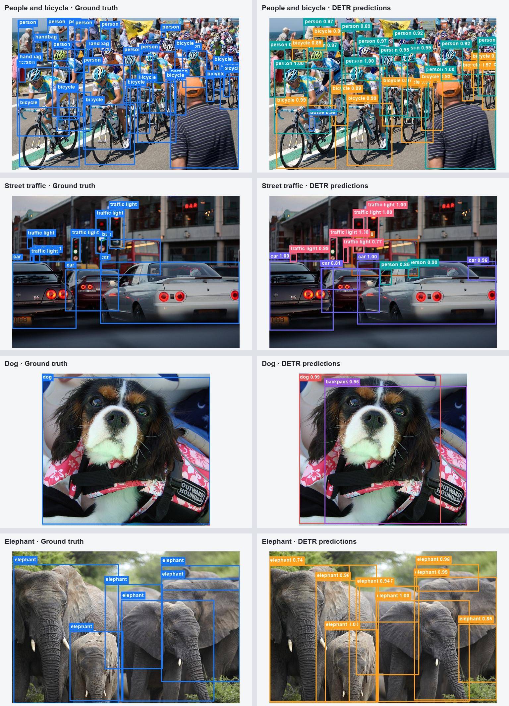
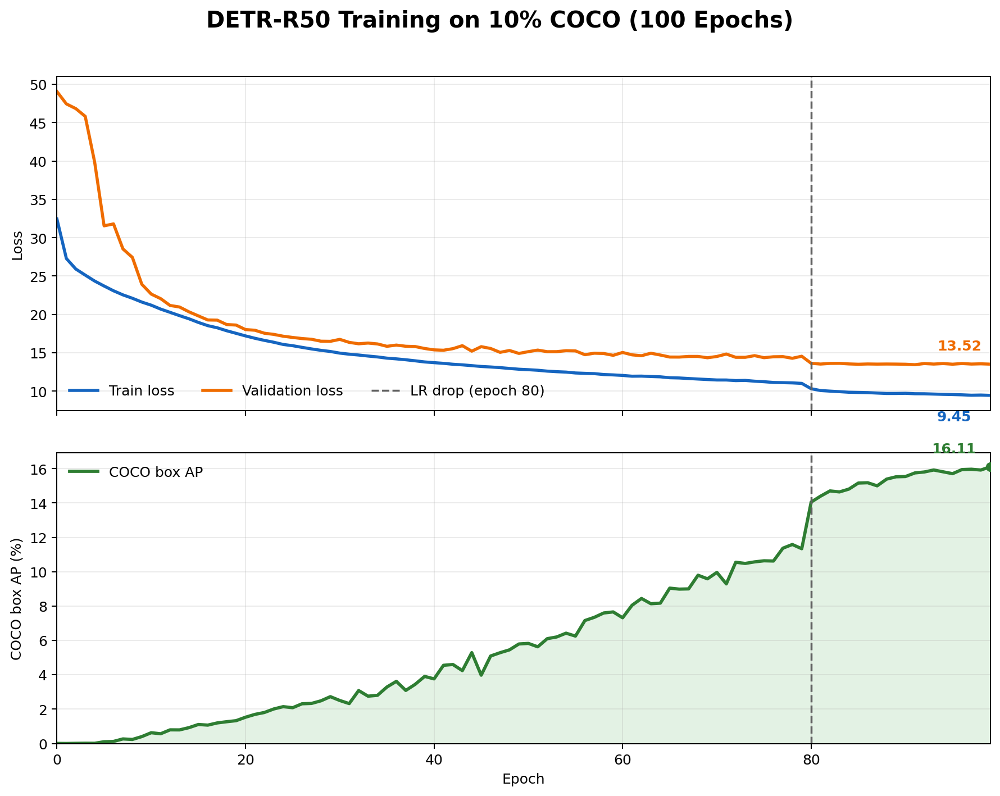

# DETR论文阅读与复现实验报告

## 摘要

DETR（DEtection TRansformer）将目标检测重新表述为端到端的集合预测问题，用 Transformer 和二分图匹配替代了锚框设计、候选框分配与非极大值抑制等人工环节。本次工作阅读并分析了 DETR 原论文，在 COCO 2017 上完成官方 DETR-R50 权重评估、全量数据训练验证以及 10% 数据的 100 轮训练实验。官方权重评估得到 AP 42.0，与论文结果一致；10% 数据实验的训练损失由 32.43 降至 9.45，最终 AP 达到 16.11。实验同时以 Git 管理代码，并补充了一键复现与结果校验流程。

## 1. 论文方法

传统目标检测器通常依赖锚框、候选区域、目标分配规则和 NMS 后处理，整个流程包含较多先验设计。DETR 的核心改变是直接预测一个无序目标集合。其结构如图1所示，主要由 CNN 主干网络、Transformer 编解码器和预测头组成。

*图1 DETR整体结构，图片来源于官方代码仓库*

输入图像首先经过 ResNet 主干网络得到二维特征图，再通过卷积将通道数压缩到 Transformer 的隐藏维度。特征图被展平为序列并加入二维位置编码，由编码器的多头自注意力建模图像不同位置之间的全局关系。解码器接收固定数量的可学习 object queries；在 DETR-R50 中共有100个 query，可将它们理解为100个“预测槽位”。每个槽位通过自注意力与其他槽位交互，并通过交叉注意力读取编码器特征，最终由共享前馈网络输出类别和归一化边界框；未匹配到真实目标的槽位输出“no object”类别。

由于真实目标和预测均为无序集合，训练时先利用匈牙利算法寻找一对一的最优匹配：

$$
\hat{\sigma}=\arg\min_{\sigma}\sum_i \mathcal{L}_{match}(y_i,\hat{y}_{\sigma(i)}).
$$

匹配代价同时考虑类别概率和边界框误差。确定匹配后，再计算分类损失以及边界框损失，其中框损失由 L1 损失和尺度不敏感的 GIoU 损失组成。一对一匹配保证每个真实目标只对应一个预测，从训练目标上抑制重复框，因此推理阶段不再需要 NMS。论文还在检测模型上增加掩码预测头，将 DETR 扩展到实例分割和全景分割，但本次实验主要复现目标检测部分。

## 2. 对论文的理解

我认为 DETR 最重要的贡献并不只是“把 Transformer 用于检测”，而是把检测流程统一成集合预测。Transformer 提供全局信息交互，匈牙利匹配则解决集合无序性和预测唯一性，两者共同构成端到端检测。object query 也不应简单理解为固定类别或固定位置的锚框，而是一组通过训练形成分工的预测槽位，它们根据整幅图像内容决定是否输出目标。

这种设计显著减少了人工规则，使检测模型更接近分类和序列建模的统一范式。不过，简化推理流程并不代表训练更容易。原始 DETR 需要300至500轮训练才能充分收敛，而且对小目标不够敏感。本次官方评估中小目标 AP 为20.5，而大目标 AP 达到61.1，也印证了这一特点。我理解其原因在于主干特征分辨率有限，同时全局注意力虽然擅长建模长距离关系，却不能直接弥补细粒度局部信息的损失。

## 3. 实验设计与结果

实验数据采用 COCO 2017。官方权重在本地 Windows 环境评估，训练实验在四张 RTX 4090 的 Linux 服务器上运行。训练环境使用 PyTorch 2.6.0、torchvision 0.21.0 和 CUDA 12.4。主要结果见表1。

| 实验 | 实际训练量 | Train loss（首→末） | Val loss（首→末） | 最终 AP |
|---|---:|---:|---:|---:|
| 官方 DETR-R50 权重评估 | COCO val2017 5000张 | — | — | 42.00 |
| 全量数据20轮计划 | 实际完成10轮 | 24.85→12.32 | 21.88→12.15 | 15.72 |
| 10%数据100轮 | 11829张，完整100轮 | 32.43→9.45 | 49.06→13.52 | 16.11 |

### 3.1 官方预训练权重评估

首先下载并校验官方 `detr-r50-e632da11.pth`，在 COCO val2017 的5000张图片上评估。结果为 AP 42.0、AP50 62.4、AP75 44.2，与官方报告一致；按目标尺寸划分，AP small、medium、large 分别为20.5、45.8和61.1。这说明本地数据、模型权重和评估流程配置正确，完成了论文已训练模型结果的复现。

*图2 官方 DETR-R50 在 COCO val2017 上的评估结果*

可视化结果表明，模型能够在街景、动物和密集人群中同时定位多个目标，并给出较高置信度；同时也能观察到遮挡场景中的漏检、边界偏差和少量类别误判。这说明 AP 汇总指标需要与定性结果结合分析。

*图3 Ground Truth与DETR预测结果对比*

### 3.2 全量数据20轮训练

随后在完整 COCO train2017 上启动20轮训练计划。该实验在主动停止前完整记录了 epoch 0—9，因此实际完成10轮。Train loss 从24.85降至12.32，val loss 从21.88降至12.15，AP 达到15.72，下降趋势清晰，证明数据读取、分布式训练、反向传播和验证流程均能正常工作。但该结果只能作为训练有效性的验证，不能等同于论文中500轮训练的最终性能。

### 3.3 10%数据100轮训练

为观察少量数据下的收敛和过拟合情况，使用 seed 42 从118287张训练图像中固定抽取11829张，即原数据的10%，在四张 GPU 上训练100轮，每卡 batch size 为4，并在第80轮将学习率降低。完整曲线如图4所示。

*图4 10% COCO 数据上的 train loss、val loss 与 AP 曲线*

训练过程中，train loss 从32.43持续降至9.45，val loss 从49.06降至13.52；AP 则由接近0逐步升至16.11，并在第99轮取得最高值。第91轮的 val loss 最低为13.45，之后略有回升，而训练损失继续下降，说明末期出现轻微的泛化差距。但 AP 仍保持上升并在最终轮达到最佳，因此尚不能判定为明显过拟合，更合理的结论是模型已经基本收敛，并开始出现轻微波动。若要更直观地制造过拟合，可进一步缩小训练集或增加训练轮数。

## 4. 工程化复现

本次工作保留了 Facebook Research 官方 DETR 的 Git 历史，并将新增内容发布到 [GitHub仓库](https://github.com/visit1111/detr-reproduction)。仓库提供 Windows 官方权重评估脚本 `reproduce.ps1` 和 Linux 四卡训练脚本 `reproduce.sh`，能够自动检查 COCO 目录、固定10%子集、校验权重 SHA-256、记录 Git 提交与依赖版本，并输出机器可读指标。数据集、权重和训练输出均不进入 Git，从而使代码修改过程清晰，同时保证其他人在准备好数据后能够按文档复现实验。

## 5. 总结

通过本次复现，我对 DETR 的理解从“基于 Transformer 的检测器”进一步转变为“由全局关系建模与集合匹配共同构成的端到端检测框架”。官方权重评估复现了 AP 42.0，自行训练实验也验证了 loss 收敛和 AP 提升。10%数据训练100轮后仅出现轻微过拟合迹象，说明模型仍受训练数据规模和训练周期影响。后续可继续尝试更小数据集上的过拟合实验，或复现分割头，并对小目标性能和收敛速度进行进一步分析。

## 参考文献

[1] Carion N, Massa F, Synnaeve G, et al. End-to-End Object Detection with Transformers[C]//European Conference on Computer Vision. 2020: 213-229.
